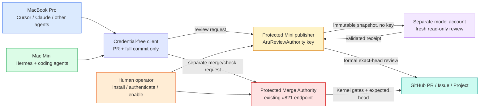

# Restricted automatic Review Authority (optional operator package)

Coding can happen on either Mac. Issue/PR creation remains an author operation
on either host. Protected review publication and governed merge submission live
on the Mini under separate identities. The credential-free client gives either
host the same narrow request interface; it does not move all coding to the Mini.

This package is source for #826, not an installed service. #827 owns live host
migration and acceptance; v3 release #792 depends on it. The receiver is disabled
by default. Kernel commands, skills, bootstrap and workflows do not import,
install, authenticate, schedule or activate it. There is no server, daemon,
queue, timer, private lifecycle ledger or automatic merge after review.



## Request and evidence

`client.py` is unprivileged. Its entire interface is:

```text
python3 client.py review --pr N --expected-head FULL_LOWERCASE_SHA [--local]
python3 client.py merge  --pr N --expected-head FULL_LOWERCASE_SHA [--local]
python3 client.py check  --pr N --expected-head FULL_LOWERCASE_SHA [--local]
```

The default is SSH to the existing `macmini` alias, with host-key verification,
no agent/X11/port forwarding, no interactive login, fixed backend paths and
validated numeric/hex arguments. `--local` invokes the same fixed endpoint on
the Mini. SSH setup and client installation belong to the human operator. Do
not use a permissive host-key policy, an arbitrary remote command, or the generic
`aru-merge-authority-run` wrapper. No unavailable-authority fallback exists.
The client binds successful output to the requested operation, PR and commit;
GitHub remains the evidence of publication and merge.

The review receiver accepts only `--pr N --expected-head SHA`, plus an
operator preflight `--check`. It fixes repository `gillella/Aru_Agentic_SDLC`
and reads a root-installed allowlist of closing issues. It rejects forks,
self-authored reviews, draft/closed/stale PRs, ambiguous closing targets,
unsupported scope and changed base/head. The App is fixed to AruReviewAuthority
(id 5268645). Permissions and the issued one-repository token are authenticated
before reading the snapshot. A completed decision is posted as a formal review,
with inline comments where the finding has a valid diff location and explicit
summary findings otherwise. Publication identity/head/state are read back;
head/base are checked again after publication. GitHub reads and writes are
non-atomic: a later push invalidates approval, and merge must revalidate its own
gates. An uncertain write is reported as a refusal, without blind retries.

The model runs as a dedicated non-admin, nonlogin `aru-review-model` principal,
never the coding/runner account or root publisher. Its clean environment has
no caller/App token. It receives GitHub file text, patches, issue and review
history as untrusted data, not a checkout. Only the sealed Antigravity executable
can execute inside the sandbox. No PR code/tests, tools other than built-in
finish, MCP or subagents are accepted. A successful real session must bind its
model, conversation, head, fresh nonce, complete changed-path coverage, findings
and limitations. Approval with findings, missing coverage, limitations or
unverified earlier Review Authority findings refuses. Verified dispositions use
the Kernel's `Resolves review: ID` convention. Other reviewers' findings and
unresolved threads remain GitHub merge gates; this package cannot waive them.

Model output and stderr have bounded storage; the session has a 900-second wall
deadline and its process group is stopped when it ends. One nonblocking lock
rejects overlapping requests immediately. Requests are not queued. An existing
latest decisive App review of this head is returned rather than duplicated.
Provider caches/scratch belong to the model account, not a lifecycle database.
Never allow coding/CI principals to replace its auth configuration or scratch.

## Immutable package and operator boundary

Build from a committed full source SHA and an explicitly selected public model
client binary with its SHA-256. `bundle.py` reads Git objects, never the dirty
working tree or credentials. It creates an exclusive, deterministic ZIP with
seven source files, the public `agy` binary and a file-hash manifest. A public
binary match establishes provenance, not current model login or live readiness.

```text
python3 integrations/review-authority/bundle.py \
  --repository /absolute/reviewed/checkout --source-head FULL_REVIEWED_SHA \
  --client-binary /absolute/selected/agy --client-sha256 CLIENT_SHA256 \
  --output /absolute/new/public-package.zip
```

Before privileged execution the human verifies the separately supplied package
hash/source approval, safely stages these fixed files beneath a new root-owned
non-writable directory, checks manifest hashes, and reviews the installer/sudo
policy. Do not run a privileged installer from a coding checkout, `/tmp`, a
symlinked/writable staging ancestor, or an unreviewed archive. No package
extraction or installation is automatic.

The installer requires isolated Apple Python, root and a human Terminal. It
refuses existing installs/policy rather than overwriting them. It requires the
separate model account with private home, a fresh private local App PEM supplied
by the human, explicit issue scope, and root-controlled staging. It creates
`/private/var/db/aru-trusted-review`, protected code/client/config, root-private
App credentials, and a digest-pinned sudo rule granting only the fixed request
script to `gillella`. Wildcards in sudo argument matching do not grant extra
capabilities: the protected script validates the exact grammar. It installs
no enablement marker. It rolls back only its new files on installation failure.
The previous laptop installation is preserved.

The human performs fresh model authentication in the model principal's private
home, App installation authentication, separate CI/author/merge/reviewer account
and privilege audits, denial tests and actual-host proofs in #827. Authenticate
with the provider's current supported flow; never copy the author's login/token
cache, expose the App key to the model, or ask a coding agent to handle a PEM.
All active CI runners must move off the ordinary coding/Hermes principal before
host acceptance. The #821 merger's own reviewed installer/admission applies
separately; this package does not install or alter it.

Only then the human runs the staged/installed `install.py enable` with root,
`/usr/bin/python3 -I` and a Terminal. It displays repository, issue scope, model
identity, source/client/interpreter hashes and config digest and requires an
explicit `ENABLE` response. The marker binds those exact bytes. A changed code,
client, interpreter, principal or config refuses later requests. Preflight
`request.py ... --check` can check App/scope while disabled; it does not run a
model or prove authentication/review publication and says so in its result.
No source-test or preflight success establishes installed/running acceptance.

`install.py disable` removes admission with explicit human confirmation. An
in-flight request checks admission before publishing, but disable cannot undo a
publication already submitted; coordinate/stop an active session first. Preserve
old installations and verified packages for rollback. Re-enabling a different
scope or release requires a separately reviewed installation, fresh host proofs
and human acceptance. No agent removes an old key or sudo grant automatically.

## Verification

Run the two offline test files through pytest and Ruff. Tests use no real App
key, GitHub API, privileged install or paid model session. They exercise actual
request grammar, nonblocking lock, complete receipt validation, stale scope,
publication binding/readback, tamper/ownership/link denials, manifest and package
determinism, transport failures and installation rollback. Exact-head Aru CI
and distinct-account GitHub approval still govern the source PR. Actual reviews
from both machines, governed merge/Closed/Done evidence, denied cross-account
access and rollback remain unverified until #827 completes.
